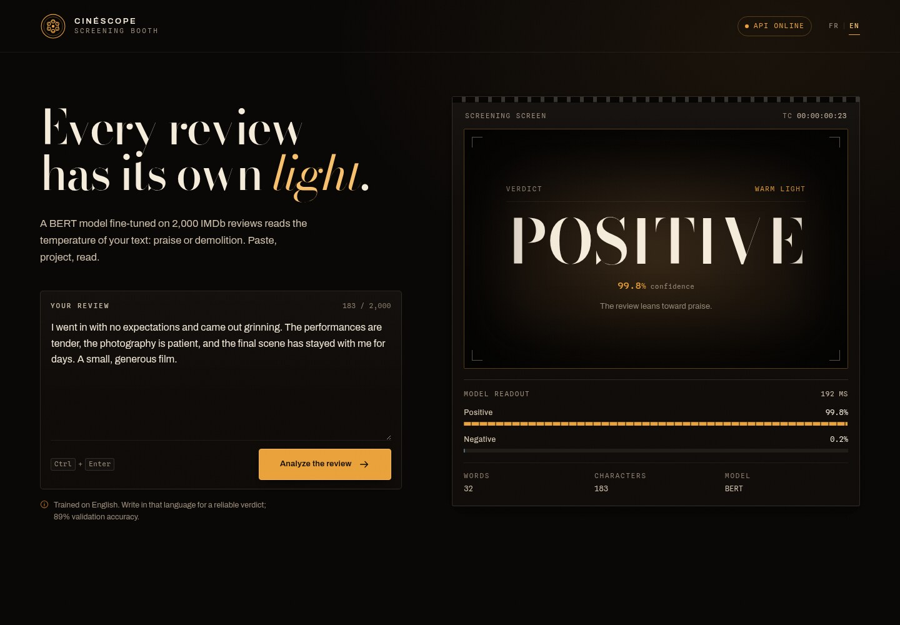
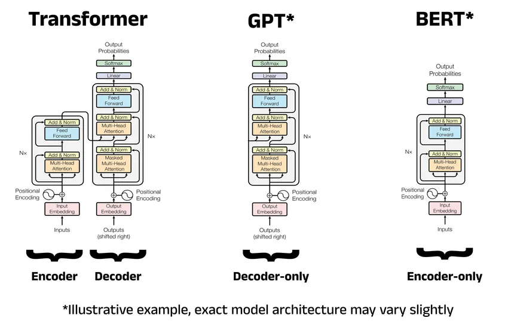

# Cinéscope — IMDb Sentiment Analysis

**Every review has its own light.**

Cinéscope is a sentiment classification app: paste a movie review in English, and a **BERT model fine-tuned on IMDb** tells you whether it leans **positive** or **negative**, with a confidence score. The result appears in a "projection booth" interface, available in both English and French.

The project is **fully containerized**: a single `docker compose up` starts the frontend, the FastAPI backend, and the model.



> Educational project by **Khadim Mbaye**. The model is a BERT-base trained on 2,000 IMDb reviews: useful for understanding fine-tuning and inference, not intended for production use.

---

## Credits & inspiration

### The video that guided me

[**DL Project 11: Build an IMDB Sentiment Classifier with BERT + Gradio UI (Full Python Tutorial)**](https://youtu.be/f5Zd8scYU40)  
by [**Siddhardhan**](https://www.youtube.com/@Siddhardhan) on YouTube.

I followed it mainly to **understand the BERT pipeline**: preparing the IMDb dataset, tokenization, loading `bert-base-uncased`, fine-tuning, evaluation, and saving the model. The video then builds a **Gradio** UI; in this repo, I extended the work with a **FastAPI API**, the **Cinéscope** frontend, Docker Compose, and this documentation.

- **Model / training**: approach inspired by the video, recorded in `notebook.ipynb`.
- **FastAPI API, frontend, Docker, docs**: built and adapted for this project.
- **Learning notes**: see [`notes.md`](notes.md) (Transformer, GPT vs BERT, attention, pipeline).

### Other credits

- Dataset: [`stanfordnlp/imdb`](https://huggingface.co/datasets/stanfordnlp/imdb) on Hugging Face.
- Libraries: [Transformers](https://huggingface.co/docs/transformers), [PyTorch](https://pytorch.org/), [FastAPI](https://fastapi.tiangolo.com/), [Uvicorn](https://www.uvicorn.org/).
- Fonts: [Bodoni Moda](https://fonts.google.com/specimen/Bodoni+Moda), [Archivo](https://fonts.google.com/specimen/Archivo), and [Spline Sans Mono](https://fonts.google.com/specimen/Spline+Sans+Mono), under the SIL OFL license and self-hosted in [`frontend/assets/fonts/`](frontend/assets/fonts/).
- Icons: SVG drawn by hand for this project.

---

## Contents

- [Credits & inspiration](#credits--inspiration)
- [At a glance](#at-a-glance)
- [Quick start](#quick-start)
- [Architecture](#architecture)
- [API](#api)
- [Model and training](#model-and-training)
- [Frontend](#frontend)
- [Repository layout](#repository-layout)
- [Configuration](#configuration)
- [Local development without Docker](#local-development-without-docker)
- [Troubleshooting](#troubleshooting)

## At a glance

| Item | Detail |
| --- | --- |
| **Task** | Binary sentiment classification (positive / negative) |
| **Model** | `bert-base-uncased` fine-tuned on IMDb |
| **Data** | 2,000 reviews, 90 / 10 split (1,800 train / 200 validation) |
| **Result** | Validation accuracy: **0.89** |
| **API** | FastAPI + Uvicorn, CPU inference |
| **Frontend** | Vanilla HTML / CSS / JS, English + French, no build step |
| **Deployment** | Docker Compose: Nginx + FastAPI + embedded model |
| **Access** | Frontend `http://localhost:3000` · API `http://localhost:8088` |

## Quick start

### Requirements

- Docker Engine 24+ with the Compose plugin.
- Around **4 GB of free disk space** and **2 GB of RAM**.
- The first build takes a few minutes: PyTorch CPU (~180 MB downloaded) and the model (~419 MB) are baked into the image. The final backend image is about **2.5 GB**.

### Run

```bash
docker compose up --build -d
```

Then open **http://localhost:3000**.

- API directly: **http://localhost:8088**
- Interactive docs: **http://localhost:8088/docs** or **http://localhost:3000/docs**
- Service health: **http://localhost:3000/api/health**

### Check

```bash
docker compose ps
curl http://localhost:8088/health
```

```json
{
  "status": "healthy",
  "model_loaded": true,
  "device": "cpu",
  "model": "imdb_bert",
  "max_length": 256,
  "uptime_seconds": 12.4
}
```

### Try a prediction

```bash
curl -X POST http://localhost:8088/predict \
  -H "Content-Type: application/json" \
  -d '{"text": "This movie was absolutely fantastic! I loved every minute of it."}'
```

```json
{
  "sentiment": "positive",
  "confidence": 0.9978281855583191,
  "probabilities": {
    "negative": 0.002171809086576104,
    "positive": 0.9978281855583191
  }
}
```

### Logs and shutdown

```bash
docker compose logs -f backend      # FastAPI logs
docker compose logs -f frontend     # Nginx logs
docker compose down                 # stop and remove the containers
docker compose up --build -d        # rebuild after a change
```

> If port `8088` is already taken by a local `uvicorn`, run `BACKEND_PORT=8090 docker compose up --build -d`. The frontend still works at `http://localhost:3000`: Nginx reaches the backend through the internal Docker network.

### After changing the model

The model is copied **into the backend image**, not mounted as a volume. After replacing `outputs/models/imdb_bert`:

```bash
docker compose build backend
docker compose up -d
```

## Architecture

```text
┌────────────────────┐        /api/*         ┌─────────────────────┐
│  Browser           │ ────────────────────▶│  Nginx (frontend)   │
│  HTML / CSS / JS   │                       │  :3000 → :80        │
└────────────────────┘                       └──────────┬──────────┘
                                                      │ internal proxy
                                                      ▼
                                           ┌─────────────────────┐
                                           │  FastAPI (backend)  │
                                           │  :8088              │
                                           └──────────┬──────────┘
                                                      │
                                                      ▼
                                           ┌─────────────────────┐
                                           │  Fine-tuned BERT    │
                                           │  IMDb (CPU)         │
                                           └─────────────────────┘
```

- The frontend always calls `/api` on its own origin, so there is no CORS setup in Docker.
- Nginx strips the `/api` prefix before forwarding to `backend:8088`.
- The backend loads the model once at startup and keeps it in memory.
- For direct API calls, CORS defaults to `*`; restrict `CORS_ORIGINS` in production.

## API

| Method | Route | Description |
| --- | --- | --- |
| `GET` | `/` | Service information and links |
| `GET` | `/health` | Status, device, uptime, max length |
| `POST` | `/predict` | Analyze a review |
| `GET` | `/docs` | Swagger UI |
| `GET` | `/redoc` | ReDoc |

### `POST /predict`

**Request**

```json
{
  "text": "A quiet, beautifully acted film. I would watch it again."
}
```

**Response**

```json
{
  "sentiment": "positive",
  "confidence": 0.9966,
  "probabilities": {
    "negative": 0.0034,
    "positive": 0.9966
  }
}
```

`text` accepts 1 to 20,000 characters. Inference is truncated to **256 tokens**. An empty string triggers a validation error; a whitespace-only string returns `400`.

### Environment variables

| Variable | Default | Purpose |
| --- | --- | --- |
| `MODEL_PATH` | `/app/models/imdb_bert` | Model directory inside the container |
| `MAX_LENGTH` | `256` | Maximum sequence length |
| `CORS_ORIGINS` | `*` | Allowed origins (comma-separated) |
| `LOG_LEVEL` | `INFO` | Python log level |
| `FRONTEND_PORT` | `3000` | Published frontend port |
| `BACKEND_PORT` | `8088` | Published API port |

## Model and training

### Why BERT?

BERT is an **encoder-only** Transformer: it reads the whole sentence bidirectionally, which suits **classifying text that is already fully written**. Unlike GPT (decoder-only), it does not generate the next token.



> Detailed diagrams and explanations (attention, embeddings, encoder/decoder, vocabulary) are in [`notes.md`](notes.md).

### Pipeline

```text
User review
      │
      ▼
Tokenization (max. 256 tokens)
      │
      ▼
Embeddings + positions
      │
      ▼
BERT blocks (attention + feed-forward) × 12
      │
      ▼
[CLS] representation → Linear → Softmax
      │
      ▼
Positive / Negative + probabilities
```

### Training details

- Base model: `bert-base-uncased`.
- Dataset: `stanfordnlp/imdb`.
- 2,000 shuffled reviews (seed 42), 90 / 10 split: 1,800 training examples, 200 validation examples.
- Hyperparameters: 3 epochs, learning rate `2e-5`, batch size 8, weight decay `0.01`, `max_length = 256`.
- Best validation accuracy: **0.89** (epoch 1). The notebook includes the classification report and confusion matrix.
- Final model: [`outputs/models/imdb_bert/`](outputs/models/imdb_bert/) (~419 MB).

> **Important**: the model is trained on **English** reviews. French reviews will be tokenized, but the verdict will not be reliable. The UI states this under the form.

## Frontend

The interface borrows the language of a projection booth: film leader, timecode, screen, tungsten light. The verdict is displayed as "warm light" (positive) or "cold light" (negative).

- **English / French** interface, preference saved in the browser.
- *Idle*, *projecting*, *result*, and *error* states.
- Verdict, confidence, probabilities, latency, and text statistics.
- Three sample reviews for one-click testing.
- Screening log of the last eight analyses, stored in `localStorage`.
- `Ctrl` / `Cmd` + `Enter` shortcut.
- Responsive from **320 px to 1440 px**, keyboard navigation, visible focus, `prefers-reduced-motion` support.
- Self-hosted fonts (no CDN), CSS/SVG grain and textures.

## Repository layout

```text
.
├── app/
│   └── main.py                  # FastAPI API
├── backend/
│   ├── Dockerfile               # API + model image
│   └── requirements.txt
├── frontend/
│   ├── index.html
│   ├── styles.css
│   ├── app.js
│   ├── nginx.conf
│   ├── Dockerfile
│   └── assets/
│       ├── favicon.svg
│       └── fonts/               # Bodoni Moda, Archivo, Spline Sans Mono + OFL
├── assets/                      # Transformer / GPT / BERT diagrams
├── docs/                        # screenshots
├── outputs/models/imdb_bert/    # fine-tuned model (copied into the image)
├── notebook.ipynb               # training and evaluation
├── notes.md                     # learning notes
├── docker-compose.yml
├── .env.example
├── PRODUCT.md
└── DESIGN.md
```

## Configuration

Defaults live in [`docker-compose.yml`](docker-compose.yml). To override them, copy the example file:

```bash
cp .env.example .env
```

Then edit `.env`:

```dotenv
FRONTEND_PORT=3000
BACKEND_PORT=8088
CORS_ORIGINS=*
```

The frontend always calls `/api` on its own origin; Nginx strips the prefix before forwarding to `backend:8088`. In Docker, there is no CORS to configure.

## Local development without Docker

Start the API with the project's Python environment:

```bash
uv run uvicorn app.main:app --reload --port 8088
```

Serve the frontend separately:

```bash
python3 -m http.server 3000 --directory frontend
```

Then open **http://localhost:3000/?api=http://localhost:8088**.

The `?api=` query parameter (or the `localStorage` key `cinescope.api`) points the frontend at an explicit backend. Without it, the frontend uses `/api`, which works in Docker through Nginx.

## Troubleshooting

| Symptom | Check |
| --- | --- |
| `port is already allocated` | Another service is using `3000` or `8088`. Change `FRONTEND_PORT` / `BACKEND_PORT` in `.env`, or stop that service. |
| Backend stays in `starting` | Loading the model takes a few seconds. Wait for the healthcheck (up to 3 minutes). |
| `API OFFLINE` in the frontend | Check `docker compose ps` and `docker compose logs backend`. |
| First build is slow | PyTorch CPU and the model are baked into the image. Later builds use Docker's cache. |
| Out of memory | BERT-base uses about 450 MB of RAM; allow at least 2 GB free. |
| Frontend does not update after a change | `docker compose build frontend && docker compose up -d frontend` — files are copied into the image. |
| Browser shows another app (e.g. Excalidraw) at `localhost:3000` | A stale service worker from a previous app is controlling that origin. Open `http://127.0.0.1:3000` (different origin), or unregister it in DevTools → Application → Service Workers, then Clear site data and reload. |

---

### Acknowledgements

Thanks to **Siddhardhan** for the video that helped me understand the BERT pipeline.

*Built as part of my learning journey in NLP and model deployment.*
