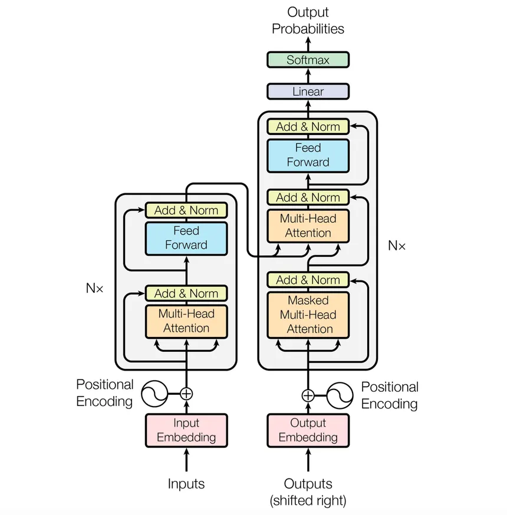
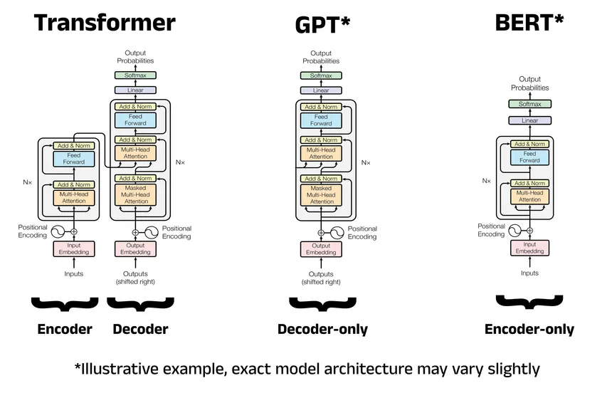

# Notes — IMDB Sentiment Analysis

> Petit carnet clair pour comprendre le **projet** et les **Transformers**.
> Phrases simples. Idées essentielles.

---

## Table des matières

1. [Le projet en 30 secondes](#1-le-projet-en-30-secondes)
2. [Pourquoi ce sujet ?](#2-pourquoi-ce-sujet-)
3. [Hugging Face & Transformers](#3-hugging-face--transformers)
4. [C’est quoi un Transformer ?](#4-cest-quoi-un-transformer-)
5. [Le schéma classique (Encoder + Decoder)](#5-le-schéma-classique-encoder--decoder)
6. [Transformer vs GPT vs BERT](#6-transformer-vs-gpt-vs-bert)
7. [Pourquoi BERT pour IMDB ?](#7-pourquoi-bert-pour-imdb-)
8. [Pipeline du projet](#8-pipeline-du-projet)
9. [Vocabulaire utile](#9-vocabulaire-utile)
10. [À retenir](#10-à-retenir)

---

## 1. Le projet en 30 secondes

On construit une app qui lit un **avis de film** (IMDB) et dit s’il est **positif** ou **négatif**.

| Élément | En clair |
|---------|----------|
| **Données** | Avis texte + label (positif / négatif) |
| **Modèle** | Un Transformer de type **BERT** (encoder-only) |
| **Sortie** | Une classe de sentiment + une confiance |

En une ligne :

> **texte → modèle → sentiment**

---

## 2. Pourquoi ce sujet ?

L’analyse de sentiment est un cas classique de **NLP** (traitement du langage).

Elle montre bien :

- comment un modèle lit du texte
- comment il transforme des mots en nombres
- comment il prend une décision (positif vs négatif)

C’est aussi un bon terrain pour comprendre **BERT**, très utilisé pour la classification de texte.

---

## 3. Hugging Face & Transformers

**Hugging Face** fournit la bibliothèque `transformers`.

Elle permet de :

- **charger** un modèle déjà entraîné
- **l’utiliser** pour prédire
- **l’entraîner / le fine-tuner** sur nos données

Sans ça, il faudrait tout reconstruire à la main avec PyTorch (ou une autre lib), ce qui est beaucoup plus long.

> En pratique : on ne part pas de zéro. On part d’un modèle prêt, puis on l’adapte à IMDB.

---

## 4. C’est quoi un Transformer ?

Un **Transformer** est une architecture de réseau de neurones créée pour le langage.

### Idée centrale

Le modèle regarde **plusieurs mots en même temps** grâce à l’**attention**.

Chaque mot se demande :

> « Quels autres mots sont importants pour me comprendre ? »

Exemple : dans *« le film n’est pas mauvais »*, le mot **pas** change tout le sens de **mauvais**.

### Blocs qu’on retrouve partout

| Bloc | Rôle (en simple) |
|------|------------------|
| **Embedding** | Transforme les mots en vecteurs (nombres) |
| **Positional Encoding** | Ajoute la position des mots (l’ordre dans la phrase) |
| **Multi-Head Attention** | Regarde les liens entre mots, plusieurs fois en parallèle |
| **Feed Forward** | Petite couche qui “travaille” sur chaque position |
| **Add & Norm** | Stabilise l’apprentissage (connexion résiduelle + normalisation) |
| **Linear + Softmax** | Transforme les scores en probabilités |

Les couches se répètent **N fois** (souvent 6, 12, etc.).

---

## 5. Le schéma classique (Encoder + Decoder)

Voici l’architecture **Transformer originale** : une partie qui **lit** (encoder) et une partie qui **écrit** (decoder).



### Lecture rapide

- **À gauche (Encoder)** : comprend le texte d’entrée
- **À droite (Decoder)** : génère le texte de sortie
- La flèche du milieu = le decoder **regarde** aussi ce que l’encoder a compris (cross-attention)
- En haut : **Linear → Softmax → probabilités** pour choisir le prochain mot

Cas typique : **traduction** (français → anglais, etc.).

---

## 6. Transformer vs GPT vs BERT

On peut garder seulement une partie du Transformer. Voici les 3 familles :



> \*Illustration : l’architecture exacte peut un peu varier selon le modèle.

### Tableau simple

| Modèle | Type | Ce qu’il voit | Usage typique |
|--------|------|---------------|---------------|
| **Transformer** | Encoder + Decoder | Texte source **et** texte cible | Traduction |
| **GPT** | Decoder-only | Le passé seulement (attention **masquée**) | Génération de texte |
| **BERT** | Encoder-only | Toute la phrase (attention **bidirectionnelle**) | Classification, compréhension |

### En phrases encore plus simples

- **Transformer complet** = lit d’un côté, écrit de l’autre → comme un **traducteur**
- **GPT** = écrit la suite mot à mot → comme un **auteur**
- **BERT** = lit bien toute la phrase → comme un **lecteur attentif**

### Attention masquée vs non masquée

| Type | Qui l’utilise | Sens |
|------|---------------|------|
| **Masquée** | GPT / decoder | Un mot **ne voit pas** le futur |
| **Non masquée** | BERT / encoder | Un mot voit **à gauche et à droite** |

C’est pour ça que BERT est excellent pour classer un avis **déjà écrit en entier**.

---

## 7. Pourquoi BERT pour IMDB ?

Pour ce projet, on utilise un modèle de type **BERT** (encoder-only).

Pourquoi ?

1. On a déjà **tout le texte** de l’avis
2. On ne génère **pas** une nouvelle phrase
3. On veut seulement une **étiquette** : positif ou négatif

### Use cases typiques de BERT

- Classification de texte ← **notre cas**
- Named Entity Recognition (NER)
- Similarité sémantique

### Idée du fine-tuning

1. On part d’un BERT déjà pré-entraîné (il “connaît” déjà un peu le langage)
2. On ajoute une petite tête de classification (**Linear → Softmax**)
3. On l’entraîne sur les avis IMDB
4. Le modèle apprend les indices de polarité (mots positifs / négatifs, négations, etc.)

> Les modèles **decoder-only** (comme GPT) servent surtout à prédire le **prochain token**. Ici, ce n’est pas le besoin principal.

---

## 8. Pipeline du projet

```text
Avis utilisateur
      │
      ▼
 Tokenisation (découper en tokens)
      │
      ▼
 Embeddings + positions
      │
      ▼
 Blocs BERT (attention + feed-forward) × N
      │
      ▼
 Vecteur résumé (souvent le token [CLS])
      │
      ▼
 Linear → Softmax
      │
      ▼
   Positif  ✅    ou    Négatif  ❌
```

### Côté produit (vue haute)

| Couche | Rôle |
|--------|------|
| **Frontend** | L’utilisateur colle un avis |
| **Backend / API** | Envoie le texte au modèle |
| **Modèle** | Renvoie le label + le score |
| **UI** | Affiche le résultat clairement |

---

## 9. Vocabulaire utile

| Mot | Sens simple |
|-----|-------------|
| **Token** | Petit morceau de texte (mot ou sous-mot) |
| **Embedding** | Représentation numérique d’un token |
| **Attention** | Mécanisme qui décide “quoi regarder” |
| **Encoder** | Partie qui **comprend** le texte |
| **Decoder** | Partie qui **génère** du texte |
| **Softmax** | Transforme des scores en probabilités (somme = 1) |
| **Fine-tuning** | Ré-entraîner un modèle déjà préparé sur une tâche précise |
| **Sentiment** | Polarité du texte : positif / négatif |
| **NLP** | Natural Language Processing = traitement du langage |

---

## 10. À retenir

1. Ce projet classifie des avis IMDB avec un modèle type **BERT**
2. Hugging Face `transformers` évite de tout coder from scratch
3. Les Transformers s’appuient sur l’**attention**
4. **GPT** génère (decoder-only), **BERT** comprend (encoder-only)
5. Pour la classification, l’**encoder** est le choix naturel
6. Les deux schémas ci-dessus résument bien la famille Transformer / GPT / BERT

---

### Mini checklist de révision

- [ ] Je sais expliquer BERT vs GPT en une phrase
- [ ] Je sais pourquoi on utilise BERT pour IMDB
- [ ] Je reconnais Embedding, Attention, Feed Forward, Softmax
- [ ] Je sais lire les 2 schémas (architecture + variantes)

---

*Notes de projet — IMDB Sentiment Analysis*  
*Dernière mise à jour : novembre 2026*
